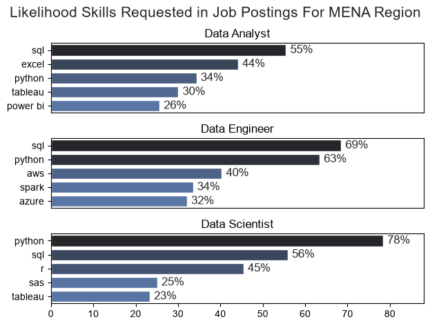
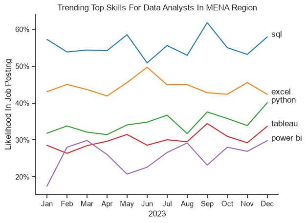
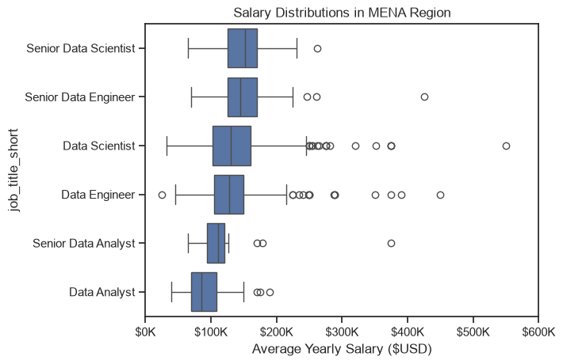
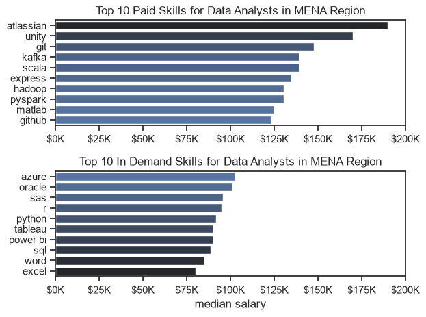
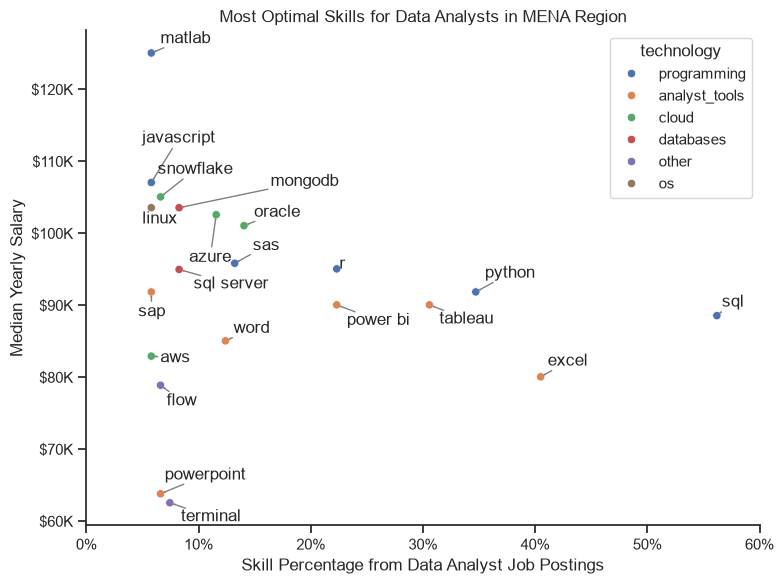

# Overview
Anyone moving into data analytics faces the same question: which skills are worth learning first? Most advice online is based on US or global data, and job markets differ by region. This project answers it for the MENA region specifically, using 121 job postings of data analyst roles with salary mentioned after filtering for MENA region countries from [Luke Barousse job postings data](https://huggingface.co/datasets/lukebarousse/data_jobs). 


# The Questions

1. What are the most demanded skills for the most popular data roles in MENA region?
2. How are in-demand skills trending for Data Analysts in MENA region?
3. How well do data roles and skills pay?
4. What is the most optimal skill to learn for Data Analysts?


# Tools Used
- Python: The backbone of my analysis, allowing me to analyze the data and find critical insights.I also used the following Python libraries:
    - Pandas Library: This was used to analyze the data.
    - Matplotlib Library: I visualized the data.
    - Seaborn Library: Helped me create more advanced visuals.
- Visual Studio Code: My go-to for executing my Python scripts.
- Git & GitHub: Essential for version control and sharing my Python code and analysis, ensuring collaboration and project tracking.

# Data Preparation and Cleanup  
This section to outline the routine of importing and cleaning the data

``` python
#Importing libraries
import pandas as pd
import matplotlib.pyplot as plt
import seaborn as sns
import ast
from datasets import load_dataset

#Loading the data
dataset = load_dataset('lukebarousse/data_jobs')
df = dataset['train'].to_pandas()

#Cleaning the date and skills columns
df['job_posted_date'] = pd.to_datetime(df['job_posted_date'])
df['job_skills'] = df['job_skills'].apply(lambda x: ast.literal_eval(x) if pd.notna(x) else x)
```
## Filtering for MENA Countries and Data Analyst Roles

I kept only Data Analyst postings in MENA countries that list both a salary and skills.
```python
# Defining countries that we will filter with
mena_countries = ['Sudan','Egypt', 'Kuwait', 'Saudi Arabia', 'Jordan', 'United Arab Emirates', 'Lebanon', 'Libya', 'Syria', 'Qatar', 'Iraq',
'Morocco', 'Palestine', 'Algeria', 'Tunisia', 'Bahrain', 'Oman', 'Yemen']

# Filtering for only data analyst job postings
df_mena_DA = df[(df['job_country'].isin(mena_countries)) & (df['job_title_short']=='Data Analyst') & (df['job_skills'].notna())
                & (df['salary_year_avg'].notna())]

```

# The Analysis

## 1. What are the most demanded skills for the most popular  data roles in MENA region?
To find the most demanded skills for the top 3 most popular data roles. I filtered out those positions by which ones were the most popular, and got the top 5 skills for these top 3 roles. This query highlights the most popular job titles and their top skills, showing which skills I should pay attention to depending on the role I'm targeting.

view my notebook with detailed steps here: [2_Skills_Count.ipynb](3_Project/2_Skills_Count.ipynb)

#### Visualize Data
```python
fig,ax = plt.subplots(3,1)

sns.set_theme(style = 'ticks')

for i,roles in enumerate(job_roles):
    df_plot = df_skill_perc[df_skill_perc['job_title_short'] == roles]
    sns.barplot(data = df_plot, y= 'job_skills', x= 'skill_percentage', ax = ax[i], hue = 'skill_count', palette = 'dark:b_r')

    ax[i].set_ylabel('')
    ax[i].set_xlabel('')
    ax[i].legend().set_visible(False)
    ax[i].set_title(roles)
    ax[i].set_xlim(0,88)

    for n,v in enumerate(df_plot['skill_percentage']):
        ax[i].text(v+1, n , f'{v:.0f}%', va= 'center')
        
    if i != 2 :
        ax[i].set_xticks([])

fig.tight_layout(h_pad=1, rect=[0, 0, 1, 0.95])
fig.suptitle('Likelihood Skills Requested in Job Postings For MENA Region', fontsize = 15)
plt.show()
```
#### Results


#### Insights
- Python is a versatile skill, highly demanded across all three roles, but most prominently for Data Scientists (78%) and Data Engineers (63%).
- SQL is the most requested skill for Data Analysts and Data Scientists, with it in over half the job postings for both roles. For Data Engineers, Python is the most sought-after skill, appearing in 63% of job postings.
- Data Engineers require more specialized technical skills (AWS, Azure, Spark) compared to Data Analysts and Data Scientists who are expected to be proficient in more general data management and analysis tools (Excel, Tableau).

## 2. How are in-demand skills trending for Data Analysts in MENA region?

#### Visualize Data
```python
sns.set_theme(style = 'ticks')


sns.lineplot(data = df_plot, dashes = False, palette = 'tab10')
sns.despine()
for i in range(5):
    plt.text(11.2,df_plot.iloc[-1,i],df_plot.columns[i])

from matplotlib.ticker import PercentFormatter

ax = plt.gca()
ax.yaxis.set_major_formatter(PercentFormatter(decimals= 0))

plt.title('Trending Top Skills For Data Analysts In MENA Region')
plt.legend().remove()
plt.xlabel('2023')
plt.ylabel('Likelihood In Job Posting')
```


#### Results



#### Insights
- SQL remains the most consistently demanded skill throughout the year, although it shows a gradual decrease in demand.

- Excel experienced a significant increase in demand starting around September, surpassing both Python and Tableau by the end of the year.

- Both Python and Tableau show relatively stable demand throughout the year with some fluctuations but remain essential skills for data analysts. Power BI, while less demanded compared to the others, shows a slight upward trend towards the year's end.

## 3. How well do data roles and skills pay?


### Salary Analysis for data jobs
#### Visualize Data
```python
sns.boxplot(data = df_mena, x = 'salary_year_avg', y= 'job_title_short', order= job_order)
sns.set_theme(style= 'ticks')
plt.title('Salary Distributions in MENA Region')
plt.xlabel('Average Yearly Salary ($USD)')
ax = plt.gca()
ax.xaxis.set_major_formatter(plt.FuncFormatter(lambda x,pos:f'${int(x/1000)}K'))
plt.xlim(0,600000)
plt.show()
```
#### Result


#### Insights
- Analysts have the lowest medians, around $85K for Data Analyst and $110K for Senior Data Analyst. Both are below even the plain Data Engineer and Data Scientist medians, which sit around $130K.

- The senior jump is small for engineers and scientists. Data Engineer to Senior Data Engineer is maybe $15-20K, and Data Scientist to Senior Data Scientist looks like roughly the same. Note the boxes overlap heavily, so many base-role postings pay as much as senior ones.

- The analyst track tops out below where the other tracks start. A Senior Data Analyst median (~$110K) is lower than a base-level Data Engineer or Data Scientist median.

### Highest paid and most demanded for data analysts 
#### Visualize Data
``` python
fig,ax = plt.subplots(2,1)
sns.set_theme(style = 'ticks')
sns.barplot(data = top_paying_skills, x ='median', y = 'job_skills', ax = ax[0], hue = 'median', palette = 'dark:b_r')

ax[0].legend().set_visible(False)
ax[0].set_title('Top 10 Paid Skills for Data Analysts in MENA Region')
ax[0].set_ylabel('')
ax[0].set_xlabel('')
ax[0].set_xlim(0,200000)
ax[0].xaxis.set_major_formatter(plt.FuncFormatter(lambda x,_ : f'${int(x/1000)}K'))

sns.barplot(data = most_popular_skills, x ='median', y = 'job_skills', ax = ax[1],  palette = 'dark:b_r')
ax[1].legend().set_visible(False)
ax[1].set_title('Top 10 In Demand Skills for Data Analysts in MENA Region')
ax[1].set_ylabel('')
ax[1].set_xlabel('median salary')
ax[1].set_xlim(0,200000)
ax[1].xaxis.set_major_formatter(plt.FuncFormatter(lambda x,_ : f'${int(x/1000)}K'))


fig.tight_layout()
plt.show()
```
#### Result


#### Insights
- The top-paying skills are engineering tools, not analyst tools. Atlassian, Unity, Git, Kafka, Scala, Hadoop and PySpark sit at roughly $125K to $190K, which is Data Engineer territory.

- The most requested skills pay the least. Excel, Word, SQL, Power BI and Tableau sit at about $80K to $90K. The two lists barely overlap, so the common skills are the entry ticket and the premium goes to rarer ones.

- Cloud and enterprise skills lead the in-demand list. Azure and Oracle top it at about $100K, while Excel and Word are at the bottom.


## 4. What is the most optimal skill to learn for Data Analysts?
#### Visualize data
``` python
from adjustText import adjust_text

plt.figure(figsize=(8,6))
sns.set_theme(style= 'ticks')

sns.scatterplot(
    data = df_plot,
    x = 'skills_percentage',
    y = 'median_salary',
    hue = 'technology'
)

sns.despine()

texts = []

for i,text in enumerate(df_DA_skills_high_demand.index):
    texts.append(plt.text(df_DA_skills_high_demand['skills_percentage'].iloc[i], df_DA_skills_high_demand['median_salary'].iloc[i],text))

ax = plt.gca()
ax.yaxis.set_major_formatter(plt.FuncFormatter(lambda y,pos : f'${int(y/1000)}K'))
ax.xaxis.set_major_formatter(plt.FuncFormatter(lambda y,pos : f'{int(y)}%'))


adjust_text(texts, expand=(1.4, 1.8), arrowprops=dict(arrowstyle='->', color='gray'))

plt.xlim(0,60)
plt.xlabel('Skill Percentage from Data Analyst Job Postings')
plt.ylabel('Median Yearly Salary')
plt.title(f'Most Optimal Skills for Data Analysts in MENA Region')
plt.tight_layout()
```
#### Results



#### Insights
- SQL, Excel, and Python are the bulk of the demand. SQL sits alone at the far right, appearing in roughly 56% of postings. Python (about 35%) and Excel (about 40%) follow. Their salaries are middling to decent (SQL and Python around $88K-$92K, Excel around $80K).

- The highest salaries sit on rare skills. Matlab (about $125K), JavaScript, Snowflake, MongoDB, and Linux all cluster at $100K+ but appear in only 5-8% of postings. Few employers ask for them, so the median is based on a small sample. Treat those salary numbers with suspicion; a handful of well-paid jobs can drag a median up a lot.

- The sweet spot is the middle. R (about 22%, $95K) and Tableau (about 30%, $90K) beat Excel on pay while still showing up in a decent share of jobs. Python at $92K with 35% share is the strongest all-rounder: high demand and above-average pay. Power BI is similar in pay to Tableau but appears less often (about 22%).

# What I Learned
 ### From the data
- SQL, Excel and Python are the baseline for Data Analysts in MENA. They show up most often, but they don't pay a premium.
- The highest salaries sit on rarer, engineering-style skills (Kafka, Scala, Hadoop, PySpark), which is closer to Data Engineer territory.
- Within analyst skills, Python, Tableau and R give the best balance of demand and pay.
- If I were starting today, I'd learn SQL and Excel first, then Python, then a BI tool such as Power BI or Tableau.
- Senior Data Analyst pay (~$110K median) sits below the base-level Data Engineer and Data Scientist medians (~$130K). My takeaway is that this pay ceiling is a likely reason analysts move into engineering or science as they gain more experience.

### From building it
- Cleaning messy nested data: the skills column was stored as strings that looked like dictionaries, and I had to convert and aggregate them before any analysis was possible.
- Learned to build complex charts in Matplotlib and Seaborn: multi-panel layouts, custom axis formatting, value labels, and a scatter plot with non-overlapping annotations.

# Conclusion
For a Data Analyst in the MENA region, the data points to a clear learning order. SQL, Excel and Python are the baseline: they appear in the largest share of postings, but they don't carry a pay premium. On the analyst side, Python, Tableau and R offer the best balance of demand and salary. The highest salaries sit on rarer, engineering-style skills such as Kafka, Scala and Hadoop, which is closer to Data Engineer territory. Since the salary analysis rests on 121 postings, I read the results as a snapshot of the market, not precise figures, especially for rare skills.

